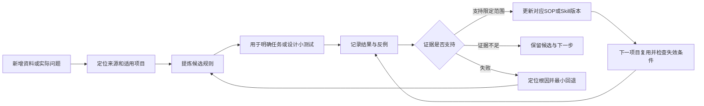

# AI漫剧持续迭代管理模型

版本：V0.1｜日期：2026-10-23｜状态：可开始使用的管理方案，尚无完整运行周期的效果数据。

建议以“原资料保留、规则有来源、生产有记录、验证后修订”为核心。现阶段用本地Markdown、CSV和原有文件即可运行。这里的迭代通过外部知识、流程和Skill版本实现，不涉及修改基础AI模型参数。

## 1 模型结构



它包含两条相互关联的线：资料进入后形成可查知识；真实任务产生结果后校正知识。每次循环只解决一个明确问题，不要求重走所有制作阶段。

## 2 四类对象分开管理

| 对象 | 应保存什么 | 权威位置 |
| --- | --- | --- |
| 原资料 | 原文、作者/来源、文件位置、版本与读取方式 | 保持现有资料库、书库、作品目录及只读包位置 |
| 可复用规则 | 解决的问题、适用条件、操作方法、反例与证据 | 初期集中在03_规则索引与首批知识记录.md；过长后再按专题拆分 |
| 项目状态 | 当前任务、有效版本、输出及未解决项 | 各作品自己的总纲或状态文件；项目中心只放链接与需同步事项 |
| 改进记录 | 问题、修改假设、结果、受影响文件与回退方式 | 初期集中在04_迭代队列与实验记录.md；有真实实验才新建完整实验条目 |

项目中心的职责是确定“读哪份、为何使用、影响哪里”。具体剧本、分镜和素材仍由对应项目文件承载。已存在的T01—T09记录不再抄一套到中心。

## 3 状态必须分开记录

文件被读过、说法有证据、方法被采用，是不同事情。

| 维度 | 建议值 | 示例 |
| --- | --- | --- |
| 阅读覆盖 | 仅登记／部分阅读／全文阅读／无法读取 | 664份PDF目前大多数仅登记，不能标为已学习 |
| 断言性质 | 原文陈述／核实事实／有据推断／待验证建议 | “SOP写着未结项”可核实；“某写法提高稳定性”仍需实验 |
| 实践证据 | 未测试／文本检查／静态样图／真实动态输出 | 有提示词不等于有视频；有视频不等于可用 |
| 采用范围 | 候选／指定项目使用／限定条件复用／停用 | 用户可先采用未实测方案，但不能因此改写其证据等级 |

这些是中心的可读标签，不替换SOP包已有F/I/H/U、E0/E1/E2和T09语义。引用包内记录时保留原标记及解释，避免同名不同义。

**有效版本判断顺序：**用户当前明确要求及有效授权 → 当前作品明确确认的基线 → 该基线指定的专项规范 → 对应操作手册 → 教学例子与外来参考。文件名、修改日期和“最终”字样只能辅助定位。出现互相矛盾的用户决定或缺少关键基线时列出具体冲突，只询问受影响的关键决定；其他研究继续进行。

## 4 一轮迭代怎样执行

### 第一步 接收与定位

触发：用户新增资料、要求整理学习、实际任务出现缺陷，或需要重新使用旧方法。先查已有索引；文件较多或状态可能变化时运行资料盘点.py生成新快照。其输出只表示文件变化，不代表正文变化的全部细节，更不能判断质量。

资料能读则登记其来源及主题；不能读则记录空文件、密码、格式或编码问题。重复候选先标记，确认内容哈希后可合并索引入口，原文件是否删除另行决定。

### 第二步 提炼一个可以使用的规则

每条规则只回答一个问题。记录：规则ID、来源位置、适用条件、具体动作、检查方法、反例或失效条件、证据、采用范围和当前版本。仅有示例时保留为表达素材，不能直接提炼成固定镜数、秒数、运镜速度或平台能力。

例如微表情词库可用于描述“刺激后眼神、呼吸、肩背如何变化”，但不能要求所有人物按相同表情与0.5秒表演。打戏跨空间设计可作为备选方法，是否换场由剧情和现有空间决定。

### 第三步 匹配真实任务

根据交付物选择一个主Skill：剧本、导演、分镜、资产、视频提示词、真实生成、审查或后期。其他Skill只补专业能力，不带入第二套交付格式。旧调用指南视为历史索引，执行前核对当前可发现Skill与实际内容。

普通资料整理只需要来源和结论；单条提示词优化只需问题、修订和检查；只有多人接触、复杂空间、真实生成等任务才展开相应专项。S1—S6包的七栏与六模块仅在该流程被选用时继承，不统一替换作品现有五列分镜等格式。

### 第四步 做最低必要验证

文档/索引修复：核对源文、版本指向和链接即可，无需生成媒体。

图像方法：明确硬约束、输入图、提示词、模型及实际输出；检查像素和画面。不能用静态图证明动态接触成立。

视频方法：保存实际输入与执行稿、平台入口和设置、源视频、可用段及问题位置，看片听声后判断。只有用户反馈而未自行审片时，明确写“用户反馈”。

在已有有效授权内执行验证；新增费用、对外发布等按真实权限处理。档案中的旧审批表不自动成为整个管理中心的新审批关卡，也不能代填已有项目所需的真实记录。本次只设计方案和记录，未开展生成实验。

### 第五步 归因并更新最小范围

依次检查资料/剧情事实、导演行动、机位与时间、资产几何、实际绑定、模型执行、后期处理。现象不能直接当成根因。每轮只改一个主要假设；必须连动的修改明确列出。

示例：房间门窗错位优先检查空间母版和参考；不能只往视频提示词加负面词，更不能据此推翻整套编剧SOP。

### 第六步 发布与恢复

草案经检查可写入候选索引；规则采用按当前任务授权与已有作品确认范围执行。正式改变跨作品默认流程、已锁定创作方向或全局Skill时，先形成有差异和依据的具体版本，按用户授权范围处理。不得把本管理方案冒充用户已批准的跨作品生产标准。

发布记录只需：版本、变化、理由、验证、适用项目、受影响下游、上一版本位置。原候选包保持只读；需修订时在新工作版本中做差异，不覆盖来源。

上游变更仅使受影响的镜头、生成单元或文档待复核；无关内容保留。回退时恢复上一适用版本及对应依赖快照，失败记录继续保留。

## 5 如何判断一个方法值得沉淀

以下为首轮运行建议，不是统计有效性结论。

1. **文本一致性规则**：来源和适用范围清楚、无相互冲突、能明确检查，即可作为文档检查项使用；不要求付费实测。
2. **生产效果规则**：一个成功样例登记为“单例经验”；建议至少在两个独立任务中复现并保留失败或限制，才标“限定条件复用”。这仍不等于普适或显著提升。
3. **跨类型复用**：需要不同类型任务支持，例如单人表演与双人交互；不从单一画风、模型版本或一段成功视频推广到所有项目。
4. **退役条件**：出现与适用条件内的反例、平台变化、上游基线替换或成本明显不合适时，标待复核/停用，保留原因与替代入口。

已有SOP提出“同一根因最多两次独立复测”的止损建议。中心建议延续其精神：两次针对同一假设的复测仍失败，先改变控制方法或重新判断根因；不是把两次失败认定为模型永远不可行。真实生成次数和花费必须由实际预算约束，本方案不预授权成本。

## 6 只记录有用的指标

| 问题 | 最少记录 | 如何比较 |
| --- | --- | --- |
| 找资料是否更快 | 任务开始到定位有效来源的实际时间 | 比较相近任务；未记录时不声称节省比例 |
| 输出是否可用 | 验看对象总数、可用数、硬性缺陷 | 只在相同验收口径与近似条件下比较；缺陷不被总分平均掩盖 |
| 返工是否减少 | 问题类别、退回步骤、额外修改次数 | 区分用户改需求、资料缺失与生成失败 |
| 视频制作成本 | 尝试次数、实际费用、有效可用秒数 | 费用/有效秒数；零可用时写无有效产出，不计算虚假比值 |
| 经验是否可靠 | 实验ID、版本、输入、结果、反例 | 明确是文档检查、静态样图还是真实视频 |

不预设“成功率提升30%”之类目标。先获得一个真实任务周期的基线，再决定值得追踪的指标。

## 7 首轮落地顺序

| 顺序 | 工作 | 完成条件 | 本轮状态 |
| --- | --- | --- | --- |
| 1 | 建基础索引、阅读边界和问题队列 | 能找到文件，能知道哪些结论未验证 | 已建立初版 |
| 2 | 解决有效版本与追溯缺口 | 植物大战僵尸总纲与实际采用稿对应；无限杀戮07缺口有真实来源或明确保留未知 | 已登记，未代替作品作决定 |
| 3 | 挑一个当前真实任务试运行 | 用一条规则解决一个实际问题，留下输入、输出与检查 | 待下一项实际任务触发，无需先整库学习 |
| 4 | 复用并精简 | 第二个独立案例能使用该规则；删掉重复填报字段 | 尚未运行 |
| 5 | 必要时再升级工具 | 文件查找或记录维护出现可测瓶颈才考虑全文检索/数据库 | 当前无新增工具需求 |

优先候选是“植物大战僵尸有效版本对齐”的文档试点：先核对总纲、四段最终稿和成片对应关系，形成当前版本入口；若需要完整审片，单独记录实际观看范围。该试点不会自动改写剧情或触发新视频生成。SOP真实生成试点沿用原包的范围和缺口，不把其他作品成片冒充该SOP已贯通。

## 8 最小记录模板

### 规则条目

```text
规则ID及版本：
要解决的问题：
来源文件及章节/页码/包内成员：
适用项目、媒介与前提：
操作方法及例外：
检查方法：
证据及反例：
阅读覆盖 / 断言性质 / 实践证据 / 采用范围：
依赖与失效条件：
```

### 实验或任务复盘

```text
实验ID / 问题ID / 日期：
目标及通过条件：
旧规则或旧版本：
本轮唯一主要修改假设：
固定条件 / 必须联动的修改：
输入文件及版本/必要时哈希：
实际工具、模型、设置和提示词版本：
输出文件 / 实际观看或核对位置：
结果、硬性缺陷、反例与未知项：
尝试次数 / 实际费用 / 实际工时：未取得的留未取得
审查者及依据：
是否采用、适用范围及原因：
更新了哪些文件 / 哪些下游需复核 / 回退入口：
```

没有实际实验时不填写假的运行结果。日常小任务可用五行复盘：问题、依据、改动、验证、下一步；不必每次填完整模板。

## 9 每次接续工作的最短读取路径

用户要求整体管理或继续迭代时：项目中心.md → 本模型 → 04队列中当前问题 → 03规则索引对应来源 → 实际项目文件。具体制作任务直接定位对应作品，不要求通读整个中心。

新增资料按任务触发处理；较长制作任务在阶段交接时更新版本状态；任务结束时补一次简短复盘。没有设置后台监控、定时任务或自动学习；用户说“新增了资料”“继续迭代”或发起具体任务时执行相应更新。

本版完成标准：资料规模可查、已读和未读分清、有证据支持的首批问题可追溯、一个实际任务能按上述路径开始运行。生产效率是否改善，留待真实周期检验。
