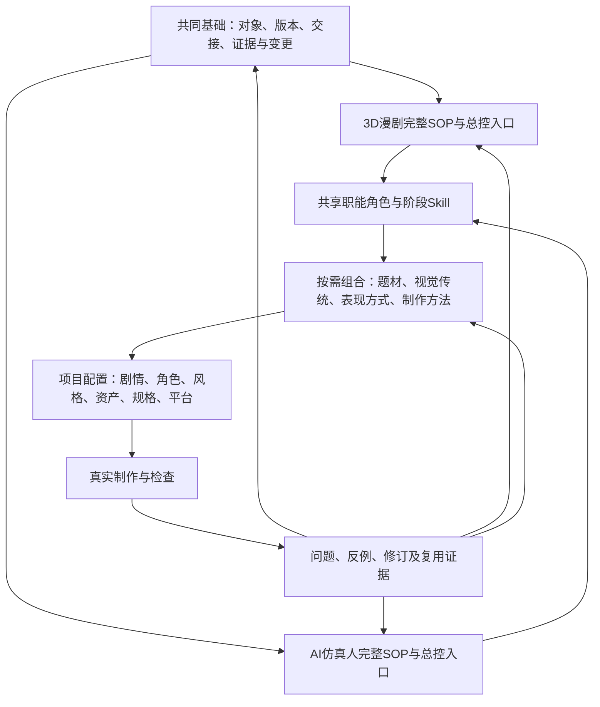

# 双路线AI叙事制作体系架构方案

版本：V1.0待审｜日期：2026-10-24。当前交付是需求澄清、专业提示词和架构设计，不是已完成的两套生产SOP，也未创建、安装或部署Agent与Skill。

## 1 已确认的目标

先建立3D漫剧与AI仿真人两套通用制作体系，每套包含完整SOP、对应总控Agent、阶段职责和Skill调用关系；具体作品在基础体系上加载题材、视觉风格和项目专属要求。项目中的有效经验经过检验后，逐步沉淀回适当层级。

用户本轮已确认：

- 全流程从创意/原著开发，经剧本、导演、视觉、资产、分镜、生成、后期，到交付与复盘。
- 先服务叙事漫剧/短剧，兼容剧情短片；不把广告、MV、纪录片、市场运营等作为首期通用覆盖目标。
- Agent先设计为可在Codex调用的角色职责、输入输出、交接和Skill组合，不建设多Agent自动调度系统。

项目中心的当前建设主线据此调整。此前07号案例任务作为相关研究工作保留，不再作为主路线；其证据与候选方法可供本体系选用，未完成项不冒认关闭。

## 2 总体架构



两个基础SOP应分别完整说明从何开始、各阶段做什么、交什么、如何检查与返工。共用规则只有一个维护源；正式版本可把共用章节与路线章节组成完整阅读版本，同时标明引用版本。首期可以人工维护这种组合，不为此先开发文档编译系统。

“共同基础”不能吞掉两条路线的专业差异；“两条路线”也不应复制两份全部相同的通用文字再分别改。共享的是工作对象和接口，差异应真实落实到设计方法、资产要求、表演、成像和验收。

## 3 五层职责

| 层 | 定义 | 该层应有的内容 | 不放在这里的内容 |
| --- | --- | --- | --- |
| 共同基础 | 两路线共同遵循的制作组织方式 | 有效剧本、场景/镜头/生成任务区别，状态连续，素材引用，版本和变更，证据与返工 | 某项目的角色、固定画幅、统一镜数或模型能力上限 |
| 路线基础 | 3D漫剧或仿真人的完整生产方法 | 专业设计与检查，阶段衔接，必要的路线差异 | 默认把某一风格等同于整个路线 |
| 专业扩展 | 跨作品重复出现的实质方法差异 | 题材机制、视觉传统、动作类型、表演方式或特殊实现方法 | 只改名称却复制整套SOP的分支 |
| 项目实例 | 一部作品本身 | 锁定故事/人物/世界、风格、阶段版本、资产、实际工具和交付规格 | 自动覆盖通用体系或其他作品 |
| 经验与版本库 | 支持改动的事实与结果 | 输入、问题、输出、反例、修改、复用条件及失效原因 | 无配置和来源的“成功口诀” |

## 4 风格与题材采用组合分类

用户举出的“国漫、美漫、风格化”等可以作为入口词，但不宜强行置于同一单层树里。

| 维度 | 可选示例 | 控制的实际内容 |
| --- | --- | --- |
| 制作路线 | 3D动漫、AI仿真人 | 形体、表演、材质、成像与检查方法 |
| 叙事题材 | 仙侠、武侠、都市、悬疑、喜剧、科幻 | 冲突机制、信息揭示、节奏与人物行动 |
| 视觉传统/参考方向 | 国漫取向、美式动画取向等 | 造型和视觉语言；必须继续写具体观察特征 |
| 表现方式 | 写实CG、卡通夸张、三渲二、绘画质感等 | 比例、轮廓、材质、光影、动作幅度 |
| 制作形态 | 连载短剧、单集短片；横屏/竖屏 | 叙事单位、复用、镜头与交付组织 |
| 实现方法与工具 | 图像参考驱动视频、三维预演辅助、其他已核实工具路线 | 输入契约、实际控制能力、参数与生成单元 |

例如“3D＋国漫取向＋仙侠题材＋适度写实CG＋竖屏连载”是一组项目选择，不等于要先建立六套完整SOP。仙侠也可以风格化，悬疑也可以国漫取向；文化方向不是固定的摄影/材质参数。

当某个配置反复产生独特的判断流程、检查标准和交付物，且可跨项目使用，再抽为专项Skill或专业Agent。只有审美参数不同的，先用风格配置和参考说明，不立即创建新Agent。

## 5 两条全流程的共同阶段与真实差异

以下是目标生命周期蓝图，不重编号旧包S1—S6，不表示已形成各阶段的完整操作手册。各阶段只在实际任务需要时启动，允许从已确认剧本或现成资产切入。

| 阶段 | 共通成果 | 3D漫剧侧重点 | 仿真人侧重点 |
| --- | --- | --- | --- |
| 创意/原著与系列开发 | 创作简报、故事引擎、改编边界、分集方向 | 动画化表达、世界尺度、动作和资产复用条件 | 人物可信度、行为动机、表演承载与空间可行性 |
| 剧本 | 当前有效剧本、人物/世界规则与场次 | 夸张程度与设定规则一致，避免为场面破坏能力逻辑 | 台词潜台词、生活行为与角色差异，动作可表演 |
| 导演与视觉路线 | 导演表达、风格依据、声音意图、视觉锚点 | 形体语言、比例、材质化简、动画节奏与可接受变形 | 人脸/年龄/体态、自然材质、实感光源、微表演与口型 |
| 单场与镜头设计 | 行动/空间状态、分镜、镜头所需资产 | 动作轮廓、速度层次、关键姿态与视觉因果 | 目光、重心、接触、微反应、机位与光源可信性 |
| 资产制作与锁定 | 角色、场景、道具、效果及必要视角 | 造型身份、装甲/衣装结构、风格一致性与动作视角 | 脸部身份、皮肤/发丝/衣料、正背结构与真实尺度 |
| 视频任务编译与生成 | 实际投喂稿、真实绑定、配置、候选原片 | 风格/形体稳定、动作张力、接触与效果边界 | 身份/表情稳定、手部/口型、自然动作与实感摄影 |
| 声音与后期 | 配音/音效/音乐、剪辑工程、工作输出 | 动画动作与声音节拍、夸张与物理反馈配合 | 说话呼吸、口型与对白、空间声及混音可信度 |
| 质量审查与交付 | 问题处置、选用片段、交付文件与检查记录 | 检查是否符合选定风格的形体/动作规则 | 检查是否破坏仿真人的身份和表演可信度 |
| 归档与复盘 | 当前版本、实际输入输出对应、经验与反例 | 提炼路线或风格有效方法 | 提炼身份、表演、成像及工具条件下的方法 |

两条路线都检查剧情、空间、接触、声音与连续性。“动画”不代表可以无因果，“仿真人”也不意味着所有场景都采用同一镜头或写实程度。

3D是目标画面与表现路线，**不强制每个项目传统建模、绑定、动画、渲染全部走一遍**。需要三维预演或实体资产时才加载该实现分支；纯AI参考图驱动也可使用3D路线。仿真人不以堆相机名、8K词汇代替实际输出检查。

## 6 Agent与Skill的分工

SOP定义流程和完成标准；Agent负责依据当前任务判断、选择、交接和处理冲突；Skill负责可重复执行的专业方法；项目配置保存这部作品的事实和选择；工具适配记录平台实际输入输出。

初期采用两个总控入口、共享职能角色的方式。下表是职责设计，不代表要同时运行一批独立进程或子Agent。

| 角色 | 决策责任 | 交付与交接 | 边界 |
| --- | --- | --- | --- |
| 3D漫剧总控 / 仿真人总控 | 选择路线、阶段、主Skill、依赖和本轮范围 | 当前任务、有效版本、专业配置、交接与问题归属 | 不代替专业创作，不扩大生成/部署授权 |
| 故事研发与编剧 | 故事、分集、人物、单集剧本 | 交有效文本和锁定事实给导演 | 不提前冻结所有镜头或资产 |
| 导演视听 | 因果、表演、场面调度、全剧视听原则 | 给镜头和美术可执行依据 | 风格选择不是重写剧情授权 |
| 美术与资产 | 身份、造型、风格、世界空间与可引用视角 | 资产和用途、状态、必要限制 | 需求清单不等于素材已存在 |
| 分镜与视频提示词 | 将导演意图转为镜头与执行文字 | 镜头、动作/时间、首尾状态、生成输入需求 | 文字可执行不代表媒体已生成 |
| 生成执行与素材管理 | 核对真实工具/配置/输入，保存结果 | 真实任务记录和候选原片 | 提交、计费与外发依当前明确授权 |
| 声音与后期 | 声画组织、编辑、混音和导出 | 源内选段、工程、输出及限制 | 不用后期掩盖剧情/素材关键缺口 |
| 质量审查 | 独立判断或如实标明自检，定位具体问题 | 有位置和影响的结论、修订归属 | 未看到/听到不判通过，不在审查时偷偷改源文件 |

知识回写由总控和项目中心维护，不额外增加一个全权“知识Agent”来复制各角色记录。独立审查只有在确有另一审查者时才这样称呼。

每个角色定义最少包含：职责、触发条件、输入、可选主Skill、交付、交接对象、检查、权限与未知项处理。初期角色定义文档可以由一个Codex助手按当前阶段使用；后续真要自动调度，再做运行平台、并发、共享状态和恢复设计。

## 7 Skill体系与复用现有能力

建议按能力拆分而非按作品复制，已有Skill先做适配评估：

| 能力域 | 当前可利用的候选 | 首期处理 |
| --- | --- | --- |
| 原著/开发/写作 | short-drama-novel-analyze、short-drama-develop、short-drama-write等 | 核对输入输出，选当前阶段所需方法，不并行叠加格式 |
| 导演/分镜 | director-agent、cinematic-director、ai-storyboard-director、Deepwhite等 | 对每次任务确定一个主流程，既有项目约定优先 |
| 风格与资产 | style-cinematography-director、realistic-human-character-design及怪物/生物专项 | 共享部分方法，分别补路线专业检查 |
| 视频表达 | film-cinedance、既定分镜/提示词Skill、seedance-vfx专项 | 分清基础提示词结构、路线差异和工具输入契约 |
| 实际生成/后期/审查 | produce-ai-video、review-and-assemble、short-drama-review | 检查边界与缺口，不因名字匹配就视为可直接接入 |

这个表是复用候选，不是宣布这些Skill已适配两路线或全部验证。不得以两套通用体系为名删除、覆盖或统一替换目前所有Skill。

新增路线Skill是否必要由差距决定。如果现有专业Skill加路线参考就能完成，不创建同义入口；如果3D形体/动作或仿真人身份/表演等专业判断没有稳定承载位置，再补专用能力。

专业Skill按需加载参考：SKILL.md保留目标、关键判断与路由；详细风格、验收和示例放相关references。`agents/openai.yaml`只是Skill相关的界面元数据等配置，不能把它当成自动运行的独立Agent系统已经建好。

## 8 专业化与项目实例的产生规则

建议顺序：选制作路线 → 明确创作目标和题材 → 确定风格参考及可观察特征 → 选择制作方法/实际工具 → 建立项目配置 → 组合对应职责与Skill。

项目配置最少保存：作品与制作形态、有效剧本、制作路线、题材与风格说明、角色/世界锁定项、真实资产入口、交付规格、当前阶段、实际工具及限制。未知处透明记录，不要求用户启动时一次填完。

不要让“国漫”三个字替代美术设计。需要具体到：轮廓/比例、五官与造型、材质处理、色彩/光影、动作/表演幅度、摄影和声音边界；哪些是全剧固定，哪些按场景变化，应分开。

项目专属Agent优先表现为“通用角色职责＋路线版本＋专业扩展＋项目配置”的组合实例。只有反复出现可复用的独特判断，才进一步提炼为跨项目专业Agent/Skill；单个角色、图号和剧情不升级成通用规则。

## 9 版本与回写

一次项目应锁定所用共同基础、路线SOP、相关Skill、专业扩展和项目配置的版本组合。上游升级先查影响，不把所有进行中的作品自动切到新版本。

问题发生后先定位层次：项目事实错误改项目；风格规则冲突改相应配置；同类题材反复需要独特方法再改专项；跨风格成立的路线问题回路线；两个路线都适用的交接问题才进入共同基础。

候选→指定范围试用→有证据的限定复用→正式采用，是建议采用状态；实际证据另记文本检查、静态图、真实视频和声音范围。正式采用可以依据用户决定，但不能因此改写实验事实。

前轮“过程时间不等于镜头时间”的经验可先作为共同检查候选；约5秒展开只属于相应BOSS要求，不作为所有视频统一持续时间。原有两案例均主要是CG，不能用它们宣称仿真人路线已验证。

## 10 建议的项目内存放位置

以下仅是后续建设目标，不在本轮创建空目录或迁移文件：

```text
03_SOP与制作标准/
  共同基础/
  3D漫剧全流程/
  AI仿真人全流程/
04_Skill管理/
  Agent职责与交接/
  通用能力映射/
  路线与专业扩展/
  研发候选/
05_模板与提示词方法/
  双路线AI叙事制作体系_架构设计主提示词_V1.0.md
作品集/各作品/已有适用文本目录/
  项目配置与入口（按该作品约定命名）
```

当前真实Skill安装入口保持原位；E盘管理来源、设计、候选与版本映射。既有书库、资料库、SOP只读包和作品路径继续保留。建立本体系不等于解决备份，原有“迁移暂缓、删除另批”仍有效。

## 11 按任务包建设的顺序

| 包 | 交付目标 | 验收依据 |
| --- | --- | --- |
| A 范围与共同接口 | 确认两路线、角色边界和生命周期；建立共通对象与交接定义 | 两套路线的对象能够关联，允许不同入口，不要求无关阶段全部重做 |
| B 双路线SOP母版 | 分别写完整3D漫剧和仿真人SOP初版，每阶段有输入、操作、输出、检查、返工 | 都覆盖从开发到复盘；差异落实到专业方法，非换标题；未测试项标明 |
| C Agent与Skill组装设计 | 双总控职责、共享角色契约、现有Skill映射和真实缺口 | 每项交付有责任方和权威源；无重复主流程，无虚构工具能力 |
| D 优先专业扩展 | 根据首个实际项目选题材/风格配置，形成必要专项候选 | 能指出与路线基础相比具体改了什么，不为分类齐全空造专业Skill |
| E 两路线代表任务验证 | 分别选择有代表性的制作任务，用真实材料检验各自链路 | 每条路线有自身证据；缺媒体或成本授权则明确尚未完成，不能纸面结项 |
| F 正式采用与迭代 | 依据结果收敛版本，提交具体采用/部署范围 | 修改有证据和回退；生成、安装、发布按实际授权；进行中项目不自动升级 |

采用任务包节奏，不安排固定周计划。先完成两份完整初版及职责映射，再选少量有差异的项目验证；不先穷举所有“国漫细分”或搭建自动Agent系统。

“初版文档完成”“Agent职责可用”“Skill组合可执行”“真实链路跑通”“可复用稳定版”是不同完成层级。每层分别报告，避免再次把候选文档或抽帧分析称为总体目标已完成。

## 12 本轮产物与下一步边界

本轮已完成需求澄清、专业主提示词和架构方案。未完成、也未启动两份正式完整SOP、全部角色文件、Skill开发、实际媒体生成或部署。现有S1—S6包只作为待映射的阶段材料，开发、声音后期、交付复盘的缺口须在B包实写，不凭已有索引补成“全流程完成”。

如果架构方向获确认，下一交付建议是A＋B：共同接口与两份全流程SOP母版；随后才进入角色/Skill适配与验证。具体需要新增专业分支时，依据真实项目选择并征求关键风格意见。

配套可复制提示词：[双路线架构设计主提示词](../../02_制作方法/03_提示词库/双路线AI叙事制作体系_架构设计主提示词_V1.0.md)。

依据：[现有SOP导航](../../02_制作方法/01_流程规范/SOP导航与版本状态.md)、[现有Skill映射](../../02_制作方法/02_专业技能/Skill目录与安装映射.md)、[迭代模型](02_持续迭代管理模型_V0.1_方案.md)。Skill组织方式参考本机skill-creator说明；本轮未执行Skill初始化、安装或验证脚本。
