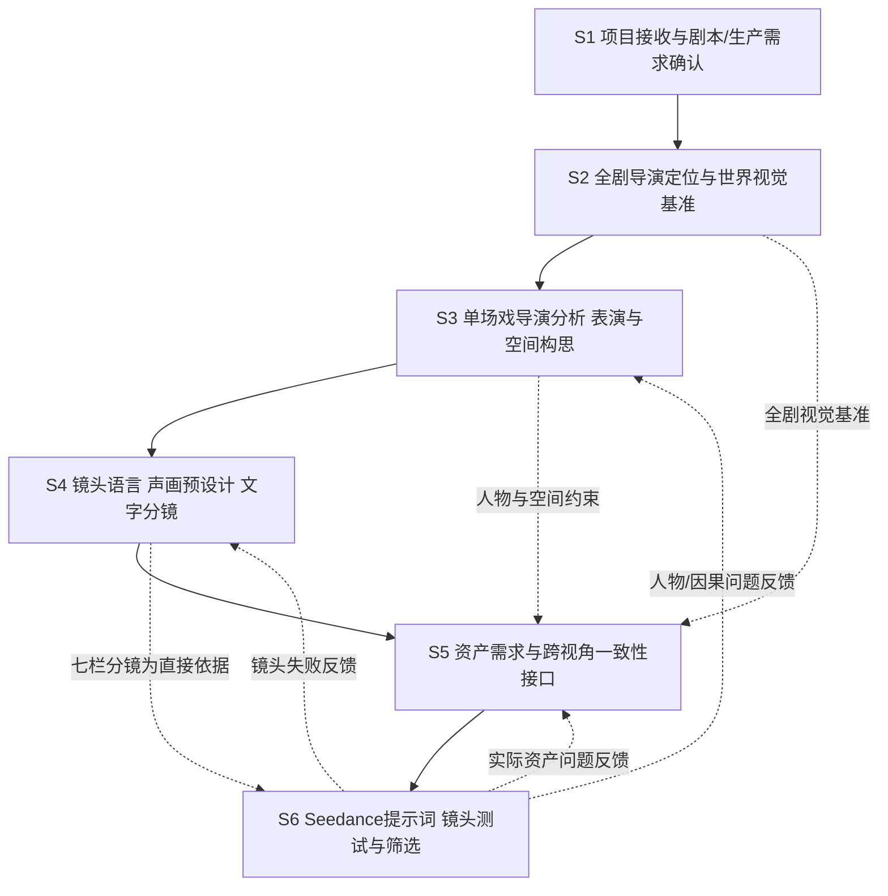

# AI短剧制作全流程操作手册｜S1—S6 整合版 V1.0

> 原始资料：20份Markdown；编制日期：2026-10-21。S5仅含接口，实际美术资产生产待用户后续资料；S7、S8不在本版。

## 目录

1. 总控与使用说明
2. S1｜项目接收与剧本／生产需求确认
3. S2｜全剧导演定位与世界视觉基准
4. S3｜单场戏导演分析、角色表演与空间构思
5. S4｜镜头语言、声画预设计与文字分镜
6. S5｜美术资产生产接口与一致性准备（待扩充）
7. S6｜Seedance提示词、镜头生成与筛选
8. 来源目录与后续补充索引


---

# AI短剧制作 SOP｜S1—S6 总控与使用说明

> 版本：V1.0｜2026-10-21  
> 基础：用户上传的20份Markdown原始资料，及《AI短剧制作全流程SOP_P1架构与文档审查报告_V1.0》  
> 本轮范围：S1—S6，共46个候选工作步骤（7+6+9+9+8+7）。  
> 不在本轮：S7后期制作；S8成片总验收、返工锁版与交付；S5角色/场景/道具资产“实际设计、提示词和生图操作”的完整专门教程。

## 0. 本套手册是什么

本套手册是把现有资料组织成**可用于生产的工作顺序、具体执行动作、必要的输出文件与交接检查**。保留原资料的专业定义与方法，不把未上传的内容写成已确定的项目标准。对于无独立依据的实际操作，仅标记“待补”，不自行填充虚构的模型功能、按钮、参数或质量分值。

- **工作层级**：项目级 S1—S6 → 单场戏导演内核（15个核心方面中的相关项）→ 专项教程 → Seedance六模块执行稿。
- **资料属性**：所有剧本事实、委托约束、有效参考需追溯到该项目实际源文件；教程中的《大燕第一纨绔》婚房戏仅是教学示例，不能自动套用于新项目。
- **四种信息状态**：已确认／有依据的推断／创作提案／待确认。不能把导演提案、参考美术画面或AI猜测当成剧本事实。
- **允许滚动生产**：场戏A通过对应工作门即可进入下一步，不必等待整剧全部完成；但引用同一场景、角色或风格基准时必须遵守同一版本。

## 1. S1—S6 流程图



> 流程图中的S5仅表示不可跳过的**资产输入条件**，不是“已经编写完毕的资产生产教程”。

## 2. 项目级工作门与主要交付

| 工作门 | 从 → 到 | 必备交付 | 没有达到时怎么办 |
|---|---|---|---|
| G1 | S1→S2 | 项目解读卡、有效剧本版本、硬约束与待确认项 | 回S1补资料；未确认项不得伪装已锁定 |
| G2 | S2→S3 | 导演风格定位报告/视听风格卡、年代与六组视觉锚点卡 | 回S2澄清观看立场与世界设定 |
| G3 | S3→S4 | 单场导演分析卡、角色表演指导、空间/动作状态约束 | 回S3解决动机、因果、站位不明 |
| G4 | S4→S5/S6准备 | 镜头方案、七栏文字分镜、声音节点、所需资产视角 | 回S4检查镜头任务、时码、动作、空间 |
| G5 | S5→S6 | 可真实引用的角色/场景/道具参考、状态/视角一致性确认 | 暂缓正式生成；等待资产规范及实际资产，或标记测试素材 |
| G6 | S6→后续 | 可用镜头文件、分镜对应关系、起止状态、声音情况及已知问题 | 未达条件的片段保留为测试素材，不能称为正式可剪镜头 |

这里的“通过”是可交接的**工作条件**，不是新增统一打分制。G6只描述向未来S7的接口，不撰写S7工作流程。

## 3. 六册索引

| 文件 | 主题 | 上游输入 | 主要结果 |
|---|---|---|---|
| 01_S1_项目接收与剧本生产需求确认.md | S1-01—S1-07 | 有效剧本、委托资料 | 项目解读卡＋场次概览＋待确认项 |
| 02_S2_全剧导演定位与世界视觉基准.md | S2-01—S2-06 | G1 | 导演视听风格卡＋全剧视觉锚点卡 |
| 03_S3_单场戏导演分析表演与空间构思.md | S3-01—S3-09 | G2＋本场及上下场剧本 | 单场导演分析卡＋表演指导表＋连续性条件 |
| 04_S4_镜头语言声画设计与文字分镜.md | S4-01—S4-09 | G3 | 镜头语言方案＋七栏文字分镜＋声音事件 |
| 05_S5_美术资产接口与待补范围.md | S5-01—S5-08的边界 | G2＋G3＋G4 | 需求和检查接口；完整操作**待用户补充** |
| 06_S6_Seedance提示词生成与镜头筛选.md | S6-01—S6-07 | G4＋G5 | 六模块执行稿＋可用镜头与状态交接 |

## 4. 全链路的不可颠倒原则

1. **事实先于创作**：S1锁定原文与要求；S3可提导演方案但必须有标记。
2. **导演意图先于机位**：剧情功能、人物行为和观众信息明确后，才在S4设计镜头。
3. **世界空间先于银幕方向**：S3先识别实体空间；S4再选择摄影轴线和机位；S5/S6复验视角与动作。
4. **分镜先于模型指令**：S6不得由提示词反向改变已确认的原台词、镜长、事件顺序。
5. **AI输出不等于自然合格**：字幕、口型、手部受力、空间和人物状态必须看实际结果。
6. **图像美术与导演表达分离**：S2决定全剧边界，S4决定本镜需要看见什么，S5将来负责真正的生图与资产版本。

## 5. 如何从零使用

**项目启动**：读S1并完成《项目解读卡》；G1通过后读S2完成两张全剧卡。  
**逐场制作**：按S3写《单场导演分析卡》及表演/空间状态；读S4定镜头后做七栏分镜。  
**资产接入**：按S5要求确认必需资产是否真实存在且跨镜一致；尚缺的资产按“待制作/待确认”挂起。  
**生成视频**：S6按有效分镜编写纯文本六模块，必要时先测试难点，检查实际样片并记录可用入点、出点。

## 6. 编制边界说明

- S1、S2、S3、S4与S6的**分析及文书写作部分**已有足够专项依据，可按源文整合为操作手册。
- S5仅保留“需求识别—视觉基准—空间视角—素材有效性—移交”的接口；不能代替未来的角色、场景、道具设计教程。
- S6的“实际平台点击操作、批次数据库、固定参数、效率/费用管理”在源文件中没有完整操作标准；本册只写源文能支持的执行链路和最小记录原则。
- S7、S8仅作为接口名出现，不进入其实际制作或验收细节。

## 7. 主要资料索引

以原始文件为准，具体逐册来源列在各册末尾。总纲：《单场戏导演创作与质量控制体系：15个核心方面》；《优秀导演的单场戏思考流程与实践方法》；8份简明制作规范；10份单场导演01—10专项教程。


---

# S1｜项目接收与剧本／生产需求确认操作手册

> 覆盖：S1-01—S1-07｜工作门：G1  
> 核心依据：《01｜专业影视项目解读：流程与结构规范》  
> 定位：**先理解要拍什么、为什么值得拍、受哪些硬性要求约束、哪些问题最难。**此阶段不做逐镜分镜。

## 一、开始前的输入与结束时的交付

**输入**：剧本及修订版本、项目简报/委托要求、已有角色/场景/道具资料、参考图或样片、交付要求、预算/排期/工具约束及既有修改意见。不存在的资料不补写为“已提供”。

**输出**：1.《项目解读卡》；2.全剧/分集场次概览（仅标剧情功能和重点场次）；3.事实/推断/提案/待确认清单；4.关键资产与生产风险预判。源文允许小项目将这些内容合并在一份MD中。

## 二、依次执行7项工作

### S1-01｜收齐原始资料

**怎么做**：集中核对剧本、委托简报、角色设定、美术参考、样片、交付要求与修改意见。记下各资料名称、版本、日期、提供者及用途；缺失资料标“待提供”。区分“参考作品的画质/光影”与“参考角色造型/空间结构”，不扩大参考授权。

**本步产出**：有效资料清单、缺项清单。**检查**：能指出每条硬约束来自哪份资料。

### S1-02｜确认有效版本和信息优先级

**怎么做**：对同一场戏存在多个剧本时，核对集数、场次、修订时间及明确生效的指示；发生冲突不得自行选更喜欢的版本。把内容标为：①已确认的剧本/委托事实；②有依据的推断；③导演创作提案；④待确认。后续所有分析引用此版本。

**本步产出**：剧本基准版本与冲突登记。**检查**：没有把提案写成剧本事实；待确认项有明确影响。

### S1-03｜识别目标、受众和最终要求

**怎么做**：确认是正式上线、客户样片、平台测试、提案展示还是个人作品；确定类型、目标观众体验、发布平台、画幅、单集时长、语言、字幕、音乐、内容限制及交付时间。对受众不要只凭“男频/女频/海外”标签推测喜好，要结合故事实际机制和项目要求。

**本步产出**：项目定位与交付硬约束。**检查**：制作人员明确什么算项目成功；不把资产图宽高比误认为最终成片画幅。

### S1-04｜完整阅读并提炼故事与人物

**怎么做**：第一遍连续阅读、暂不拆镜；第二遍提炼“一句话故事：谁想得到什么、面临何种阻力、失败的后果”，然后写主角行动线、主要对手与关系、冲突如何升级、信息如何揭示。把“剧情摘要”与“核心观看动力”分开写。

**本步产出**：一句话故事、人物关系、主要冲突和卖点排序。**检查**：不是事件流水账，能够指出为何观众愿意继续看。

### S1-05｜建立故事脊柱及重点场次

**怎么做**：把全剧梳理为“故事起点→触发事件→主要升级→关键转折→高潮回报→新悬念/结局”；在场次概览中标出首次建立人物、身份揭示、关系转折、动作高潮、情绪高潮、世界规则与结尾钩子。此时只做功能标记，不做S3的细致分析，更不为每场预设焦距。

**本步产出**：故事脊柱与重点场次清单。**检查**：指出哪些场戏不能拍丢、哪些信息不能提前暴露。

### S1-06｜初盘资产、状态和制作风险

**怎么做**：统计剧本中主要角色与服装/妆伤变化、高复用场景与出入口、剧情关键道具及交接、人物状态转变、特殊声音。再识别高风险动作（抓握/多人打斗/上下交通工具）、表演（醉态、微表情）、空间（主反打/俯视/室内外连接）、声音（指定台词、口型、无字幕）及资产状态。必要时提出**一个3—8秒代表性测试**或主反打组合，目标是验证难点而非抢先大批量制作。

**本步产出**：初步资产清单、复杂度风险及最小验证建议。**检查**：风险描述指向具体场戏及可观察问题；不只写“制作有难度”。

### S1-07｜形成项目解读并交给S2

**怎么做**：将前面结果合为《项目解读卡》；明确“确定的事、暂不能确定的事、导演风格需要回答的事、视觉年代需要查证的事、应优先测试的场次”。不要在此正式选定S2的摄影和声音风格。

**本步产出**：《项目解读卡》V1.0与待确认事项；提交G1。

## 三、直接可用的《项目解读卡》

```markdown
# 项目解读卡｜项目名称｜版本

## 1 基础信息
- 项目用途／作品类型：
- 生效剧本版本／集数／场次范围：
- 受众／平台／语言：
- 成片画幅／目标时长／字幕与声音要求：
- 交付时间／预算和工具边界：

## 2 故事与观众回报
- 一句话故事（主角目标—阻力—失败后果）：
- 主导冲突与人物关系：
- 核心看点1—3项：
- 观众信息揭示顺序：
- 故事脊柱（起点—升级—转折—高潮/结局）：

## 3 制作事实与约束
- 已确认的剧本事实：
- 委托方不能更改的要求：
- 已批准参考及限定用途：
- 有依据的推断／导演提案（分别标明）：

## 4 规模、资产与风险
- 主要角色／造型状态：
- 主要场景／室内外连接：
- 关键道具／动作状态：
- 主要声音要求：
- 高风险场次／最小验证建议：

## 5 下游交接
- S2导演风格应解决：
- S2年代视觉基准应解决：
- 待确认事项（问题／影响／确认者）：
```

## 四、G1合格检查

- [ ] 剧本有效版本唯一，原文台词与重要事实可追溯。
- [ ] 可以用三句话说明故事、卖点和主要观众体验。
- [ ] 画幅、时长、平台、语言、交付边界明确；未明确则标待确认。
- [ ] 重点场次与不可省略的信息节点已列出。
- [ ] 高复用角色、场景、道具、动作状态与声音要求得到初盘。
- [ ] 有明确需要S2决定的导演/视觉问题；S1没有越级固定逐镜机位。

**常见退回**：若剧本冲突，回S1-02；若无法说清观看动力，回S1-04/05；若关键动作无法拍摄/生成，先标风险并传S2与S4进行验证设计，不能靠“超真实”词汇消除风险。

## 五、源文与未覆盖项

**直接依据**：《01｜专业影视项目解读：流程与结构规范(1).md》“七步完成项目解读”“标准交付结构”；《单场戏导演创作与质量控制体系：15个核心方面》中的“制作可行性”摘要。  
**本轮不编写**：创意立项前的原创剧本开发、详细制片预算/人员排期、合同版权审核的专门方法；源资料尚无同等深度SOP。


---

# S2｜全剧导演定位与世界视觉基准操作手册

> 覆盖：S2-01—S2-06｜工作门：G2  
> 核心依据：《02｜导演风格定位：选择流程与视听表达规范》与《03｜历史年代与全剧视觉锚点定位：流程与结构规范》  
> 本阶段解决两件互相约束、但不能混为一谈的事：**观众怎样看/感受故事**（导演风格）；**世界里的人、物、空间应该长什么样**（视觉锚点）。

## 一、输入/输出

**输入**：G1《项目解读卡》、有效剧本、已批准的项目约束、已有参考图/样片、核心场戏与风险列表。

**输出**：①《导演风格定位报告》（比较候选方案和理由）；②《导演视听风格卡》（常态规则与特殊场次）；③《全剧视觉锚点卡》（年代证据与六组锚点）；④有明确用途的参考图/镜头组；⑤代表场次验证结论。所有未验证/未获批的内容保留状态标识。

## 二、六项工作怎样实施

### S2-01｜找出主导戏剧机制与观众体验

读取S1的主角目标、主要阻力、剧情转折、观众回报，确认一部剧的主要运作方式：如身份/权力反转、关系变化、悬疑、误会、动作英雄性、恐惧等，可有辅助机制。将之压缩为三项：**叙事目标**（观众须明白的变化）、**情绪目标**（从什么体验到什么体验）、**观看立场**（观众跟随谁、谁知道哪些信息）。同一种题材也可能需要不同导演表达，不以“古装”“女频”替代分析。

**产出**：主机制、次机制及切换条件，导演核心命题初稿。

### S2-02｜形成全剧导演表达原则

围绕核心命题依次决定8项规则：叙事立场、人物表演、人物调度、摄影基线、剪辑节奏、声音叙事、视觉协同、AI执行边界。每项使用“**在什么戏剧条件下→采用何种表达→观众得到什么信息/感受→禁止哪种失真**”的句式。此时设定的是原则，不是具体SH001机位/秒数。

**示例**：“人物醉态需要清晰可读时，以稳定画框保留腿部动作，让不均匀步态和补步成为表演信息；不靠乱晃镜头替代演员醉态。”

### S2-03｜比较导演风格方向与参考方法

先提出2—3个实质不同的表达方向（例如清晰商业叙事、人物沉浸、动作视觉冲击），逐一说明优势、代价及适用场戏，选择能同时服务剧本和实际AI能力的一种。找戏剧功能相似的影视片段，分别观察人物目标、信息揭示、表演调度、景别选择、镜头切点与声画关系。记录**可迁移的方法**与**不能照搬的元素**。导演参考与美术参考分别存档。

**产出**：候选对照＋最终推荐理由＋来源参考属性。未经确认的方向不得写成“已锁”。

### S2-04｜核对时代、地域、世界观与证据

先判为：A明确历史时期；B有历史原型的架空世界；C完全虚构的科幻/玄幻世界；D现代/近现代特定地区。提取剧本中的制度、职业、服饰、建筑、器具、交通、技术、气候、礼仪等信息。历史项目核对博物馆/研究/图录等可靠资料；影视剧照更多用于美学而非历史事实。写出“已确认/参考原型/待考证”，不能凭虚构国号推断真实朝代。

**产出**：年代/世界观证据表、风格化改造的允许边界与穿帮禁区。

### S2-05｜定义全剧六组视觉锚点

建立六组稳定规则：①建筑/空间；②人物/服饰；③道具/生活细节；④色彩/对比；⑤光影/成像；⑥媒介/材质（真人实拍感/写实CG/动画等）。同时区分三层：**G全剧不变量、S场景母版、SH镜头特例**。不在S2绘制所有角色三视图，也不在S2替S5编写生图指令。

针对日/夜、内/外、不同阶层、情绪高点等，写清**允许变化**与**不应变化**。对高复用空间提出母版需求：主视、反打、平面/俯视或室内外连接视角；强调反打不能是简单镜像。素材图可能是16:9，最终9:16成片需另检查安全构图。

**产出**：六组视觉锚点＋参考图使用权限/边界＋核心场景母版需求。

### S2-06｜代表场次验证与锁定

从实际剧本中按需选择人物关系戏、复杂动作/调度戏、环境/氛围戏。测试项目关注的不是一张单独“好图”，而是表演、场景主反打、角色身份、光线材质与视频动作/声音是否稳定。最小测试素材必须注明是**探索样片**还是已获批参考，不能因一镜成功假定整剧可稳定完成。

形成**全剧常态规则、特殊场次条件规则、已确认项、待确认项和下游所需信息**；提交G2。若用户尚未提供S5专业资产流程，可以在这里锁定风格与设计意图，但“真实资产已制作”仍保持待定。

## 三、直接使用的导演视听风格卡

```markdown
# 导演视听风格卡｜项目｜版本
- 有效剧本与项目解读卡：
- 主导戏剧机制／次机制：
- 核心导演命题（叙事、情绪、观看立场）：
- 候选A/B(/C)及选择理由：
- 影视方法参考（只参考的机制／不参考项）：

## 全剧八项规则
1. 叙事立场与信息揭示：
2. 人物表演强度、行动与反应：
3. 空间/人物调度：
4. 景别/机位/固定与运镜的选择原则：
5. 叙事信息与情绪节奏、切镜条件：
6. SYNC/OS/VO/环境/动作声/音乐/静默原则：
7. 与年代、资产与光影基准的协同：
8. AI风险、拆镜与最小验证原则：

## 特殊场次允许变化
- 反转：
- 关系情绪戏：
- 动作/悬疑/回忆（按实际项目）：
- 不可突破的剧本/空间/声音边界：

## 验证与交接
- 代表性场次测试及结论：
- 规则状态（已确认/测试中/提案）：
- 交给S3/S4/S5的约束：
```

## 四、直接使用的全剧视觉锚点卡

```markdown
# 全剧视觉锚点卡｜项目｜版本

## 年代和世界证据
- 历史明确／历史原型架空／完全虚构／特定现代区域：
- 地域、身份等级、生活规则与依据：
- 可影视化设计的部分：
- 待核验／禁止混搭：

## 视觉定位一句话
[时代/文化依据]+[题材与阶层]+[媒介写实程度]+[视觉气质]+[允许边界]

| 视觉锚点 | 全剧不变量 G | 允许场景变化 S | 参考属性与待确认 |
|---|---|---|---|
| 建筑与空间 | | | |
| 人物与服饰 | | | |
| 道具与生活细节 | | | |
| 色彩与对比 | | | |
| 光影与成像 | | | |
| 媒介与材质 | | | |

## 场景与镜头继承
- 关键场景母版（几何/出入口/光源）：
- 必需的主视/反打/俯视/连接视角：
- 角色/服装/道具状态变体：
- 资产图画幅与最终成片画幅：
- 镜头级可变项 SH：

## 参考与验证
- 参考图/视频：只借鉴什么、不借鉴什么：
- 日/夜、内/外、近景与主反打的测试状态：
- 已确认／待确认／待实际资产制作：
```

## 五、G2合格检查

- [ ] “怎么讲故事”与“世界长什么样”分开定义，互相不矛盾。
- [ ] 已说明选定方向为何匹配主导戏剧机制，至少比较两种方向。
- [ ] 全剧8项视听规则能直接影响S3/S4的实际选择。
- [ ] 世界设定与时代依据的确定程度准确；不将参考片混为考古事实。
- [ ] 六组视觉锚点有全剧不变量、场景变化和镜头特例区分。
- [ ] 关键场次有验证方案，尚未实现的样片/资产不能标记“已完成”。

**源文**：《02｜导演风格定位：选择流程与视听表达规范(1).md》；《02｜历史年代与全剧视觉锚点定位：流程与结构规范(1).md》（文内题名“03”）；《单场戏导演创作体系｜09 视觉美术》V1.0(2).md（导演层面）。


---

# S3｜单场戏导演分析、角色表演与空间构思操作手册

> 覆盖：S3-01—S3-09｜工作门：G3  
> 主体依据：单场戏导演体系01—07七份专项教程；《高水准导演思维：剧本分析流程与结构规范》；《角色表演分析与指导：流程与结构规范》；《优秀导演的单场戏思考流程与实践方法》。

## 一、S3的目标：先确定“为什么拍”和“人物做什么”

本阶段并不是把剧本文字改成“生动的小说描述”，更不是先指定35mm、低角度或Seedance提示词。S3结束时应能准确解释：**该场戏对故事造成的变化→人物目标与阻力→冲突如何按因果递进→观众如何感受信息→人物通过哪些具体行为完成→人物与道具在同一空间如何行动。**

**输入**：G2全剧视听风格卡与视觉锚点卡；有效剧本中本场与上下场；剧中角色既定信息；已确认的空间/道具资料（若尚无则明确未锁定）。

**交付组合**：一张综合《单场导演分析卡》＋一张六栏《角色表演指导表》＋空间锚点/状态链/必要的场面调度图。重点场戏可以补充专题分析，普通对话戏优先采用短表，不自动增加7份彼此重复的独立报告。

## 二、九项工作的执行流程

### S3-01｜核对原文、上下场状态与事件事实

1. 抄出本场项目、集、场、时间地点、出场人物、当前剧本版本。
2. 从上一场读取角色已经知道的消息、人物站姿/坐姿、服装伤势、道具持有及正在发生的动作；把本场事件逐条按照原文顺序列出。
3. 标记每条内容是**F事实、I有依据推断、H导演创作假设、U待确认**；例如原文只写“杨辰扯开红盖头”，额外停顿和目光属于导演提案，不当作剧本原文。
4. 记录接入本场与离开本场时需要连续保持的状态。

**输出**：原文事件表＋起止状态。**不能通过**：改写原台词、添加没有得到批准的新剧情、角色提前知道不可能知道的事。

### S3-02｜判断场戏的剧情功能

依次问：如果删掉这场戏，人物关系、剧情因果、信息或氛围会失去什么？本场的主功能是哪一种：推进剧情、建立人物、改变关系、揭露关键信息、建立伏笔、制造转折、建立世界规则、调整叙事节奏/气氛？多功能时按主次排列，不要求每场都反转。

用“**入场状态→核心事件→出场状态变化**”写成一句可验证的场次功能。例如：“人物关系由口头抗拒升级为身体直接对抗”，而不是“演出张力、戏很精彩”。划定压缩时长绝不能丢失的信息、动作与结局。

**输出**：主功能、次功能、变化证据与不可删核心。**检查**：能指出哪个原文动作/信息引起变化；没有用“事件很多”代替功能。

### S3-03｜逐人分析目标、动机、阻碍与策略

只分析出现在本场、能影响行动的人物。先写**规定情境**（身份、位置、身体状态、已知信息、受限条件），再区分长期目标、本场目标、此刻即时目标；明确为什么要得到这个结果，什么阻止，失败代价是什么，采取请求/试探/回避/逼问/阻拦等什么策略。把人物关系、潜台词与主观判断单独表述，并写明策略改变的触发点。

**建议最小分析结构**：`人物姓名｜入场事实与已知信息｜本场目标｜阻碍/代价｜当前策略｜引发改策的新刺激｜离场状态`。

**常见纠正**：“很生气”是情绪而非目标；“天生阴狠/已有隐秘身世”没有剧本依据时不能编入人物资料；身份高低不能直接替代当下行动主动权。

### S3-04｜梳理冲突、行动反馈与戏剧节拍

先列出冲突双方（也可能是环境、制度、自我认知），写清双方目标为何难以兼容。用`目标→阻碍→行动→对手/环境反馈→判断或策略改变→新局面`分析因果。**节拍的分界**应是发生新刺激、新策略、新认知或局势变化，而不是每一句话都切一次。

按戏剧复杂度摘录关键节拍；每拍至少有“触发、角色行动、对手反馈、变化”。标出升级是否真的提高了难度/风险/紧迫性，还是仅提高音量；标出转折前后哪个条件质变。该分析会直接决定S4应完整拍清的动作节点。

**输出**：冲突核心句、行动—反馈链、节拍序列及转折。**检查**：静态重复争吵不能被误称“逐步升级”。

### S3-05｜设计观众视点、信息揭示与体验路径

读取前场结束时观众已经知道、误以为、期待的内容；判断主导叙事视点（不等于必须第一人称POV）、核心观看问题与信息揭露顺序。逐拍写“观众此刻比角色多知道/少知道/知道同样多什么—接下来最想确认什么—由哪个动作/声音让认识变化”。

把**人物情绪**与**观众情绪**分开。例如角色不知门外有人，观众已知伏击，因此角色平静但观众紧张。情绪曲线不应每拍都是“更紧张”，允许预期、担忧、缓冲、怀疑、回报，具体由剧本结构决定。

**输出**：主导观看立场、信息表、核心疑问、节拍体验与离场期待。**检查**：不能保证“观众一定怎样”，只能解释视听条件为何有可能产生预期体验。

### S3-06｜把人物目标转换成可信表演指令

以`刺激→感知/判断→为达成目标采取行动→对手反馈→角色状态更新`为骨架，把情绪形容词翻译为**可观察行为**：眼神何时转向、身体是否停顿、手部何时抓握、语速如何服务说话目的、两人如何倾听回应。每个关键表演节点明确谁先行动、谁看到后才反应，不能让角色凭空提前察觉别人的心理OS。

严格保留原文台词，区分SYNC（现场对白、匹配口型）、OS（内心）、VO（画外/叙述）；情绪强度遵守S2的类型基线，真实不等于一律面无表情。不要一口气写皱眉、咬唇、颤抖、落泪等大量微表情；选能使观众理解的1—2处关键变化。

**输出**：单场表演分析卡＋六栏指导表（附模板）。**检查**：目的明确、触发有据、双人反馈可信、物理动作可执行。

### S3-07｜设计场面调度和人物运动路线

先确定空间现实：门、窗、床、桌、障碍、通道、人物初始站位及可交互物体，未知就记录未知，不靠AI想象“已经批准的房间”。在空间草图上为每个节拍记录角色位置、面朝、距离、视线和移动路线。

采用源文“**先静后动**”的思路：先假设角色保持位置，只有人物目标、外界刺激或关系变化要求移动才增加动作。所有靠近、回避、退让、阻拦、接触都有触发；多人物戏要看相互位置、视线遮挡与前后景分组。道具移动与身体接触必须考虑支撑点、力度与现实重心。

**输出**：分节拍走位草图＋入/出场站位＋道具交互需求。**检查**：动作路径可实现、不穿越家具，不为摄影机移动强迫演员无意义走路。

### S3-08｜建立空间和动作连续性母约束

严格区分**三维世界空间**与**二维银幕方向**：房间内“北侧的门”不等于每个镜头都出现在画面左侧。先登记场景几何固定锚点，再以状态ID（S0、S1…）表示重要事件前后人物姿势、位置、手持、服装、道具与声音变化。

对接触动作可采用：`起手→接触→施力→物体/对手反馈→动作完成`的相位检查；跨镜不能反过来。记录主要两人关系轴线、行动轴线与允许机位区间供S4引用；无需在S3逐镜写摄影参数。若目前没有真实S5母版，只能写**候选空间约束/待S5验证**，不能假称主反打空间已锁定。

**输出**：空间锚点清单、人物/道具状态链、关键动作相位和摄影视线约束。

### S3-09｜整合导演结论并交接S4

把前8步浓缩为：本场为什么存在、人物怎样推动变化、观众需要何时得知什么、必须拍清哪些动作与回应、哪些表演/空间约束不能破坏、潜在AI风险与测试条件。移交S4是导演**内容决策**，并非已设计好的镜头清单。

**输出**：一张完整的《单场导演分析卡》、必要六栏表演指导表、空间及状态信息；提交G3。

## 三、合并版《单场导演分析卡》模板

```markdown
# 单场导演分析卡｜项目/集/场｜剧本版本
- 场景时间与地点：
- 本场角色（逐人列名）：
- 已确定的前一场尾态／本场起态：
- 剧本事实F（原文事件与台词，不擅改）：
- 推断I、导演提案H、待确认U（分别列）：

## 1 剧情功能
- 主功能／次功能及依据：
- 入场状态→出场变化：
- 时长压缩时必保留的事件/信息：

## 2 人物行动（逐人填写）
| 角色姓名 | 已知信息与规定情境 | 当下目标 | 阻碍/代价 | 行动策略 | 转变触发 | 离场状态 |
|---|---|---|---|---|---|---|
| | | | | | | |

## 3 戏剧冲突与节拍
- 核心对立：
| 节拍ID | 新刺激/信息 | 角色行动 | 对手反馈 | 冲突/关系变化 |
|---|---|---|---|---|
| B01 | | | | |
- 真正的升级与关键转折：

## 4 观众体验
- 入场观众认知／主要疑问：
- 主导观看立场与角色信息差：
- 信息揭示顺序：
- 体验变化（节拍→观众理解→预期情绪）：
- 离场理解、预期或悬念：

## 5 表演与空间设计
- 哪些动作或表演必须清晰可见：
- 哪些对手反应不能省略：
- 原文SYNC/OS/VO要求：
- 人物初始位置与移动原因：
- 场景固定锚点／空间尚待确认项：
- 关键手部、道具、动作相位与出态：

## 6 S4交接
- 观众一定要看清/听清的信息：
- 不可破坏的动作先后及状态链：
- 可以在镜头层作选择的部分：
- AI制作风险、待验证设计提案：
```

## 四、六栏《角色表演指导表》模板（来源简明规范）

| 角色／表演节点 | 此刻目标与心理判断 | 触发刺激 | 可见动作与微表演 | 台词与声音 | 对手反馈／结尾状态 |
|---|---|---|---|---|---|
| [姓名/B01] | [要达成什么] | [角色实际看/听到什么] | [视线、身体、手部和必要表情] | [原句｜SYNC/OS/VO｜语气目的] | [具体姓名的反馈与出态] |

**指导要求**：一行对应一次有意义的表演/心理转折，不必一秒或一句台词一行。对于复杂接触镜头明确双手的不同接触/施力点；避免以“抓住对方”替代可见物理动作。

## 五、场面调度与连续性三种基本记录

### A. 空间锚点表

| 锚点ID | 世界中的固定位置/功能 | 已确认的参考 | 待S5验证内容 |
|---|---|---|---|
| G01 | [门窗家具/出入口] | [场景母版或剧本] | [具体位置、尺度等] |

### B. 动作/道具状态链

| 状态ID | 触发动作 | 角色A（姓名与姿势） | 角色B（姓名与姿势） | 关键物件/服装 | 下一镜允许承接 |
|---|---|---|---|---|---|
| S0 | [事件之前] | | | | S1 |
| S1 | [接触后/事件之后] | | | | S2 |

### C. 需要S4验证的机位与动作边界

- 主要对话/行动轴线：
- 视线目标与可见性：
- 不得被镜头切断的接触相位：
- 若有意换轴，观众应如何重新建立空间：
- 必须保留的跨镜道具和声源状态：

## 六、G3交接检查

- [ ] 每项具体主张都能区分F/I/H/U；原台词无未经同意的改写。
- [ ] 戏剧功能与入场/离场变化明确，不靠反转强度衡量每场戏。
- [ ] 主要角色目标、阻碍、策略及回应能形成因果链。
- [ ] 节拍按行动/认知/局势变化划分，不按每句对白机械分段。
- [ ] 观众视点和信息差清楚；人物情绪与观众情绪分开。
- [ ] 表演指令由目的/刺激触发，可观察、不过载、符合该剧风格。
- [ ] 站位、走位、道具交互、身体重心与状态链可推导；未知空间标待确认。
- [ ] 交给S4的是“必须看清什么/为什么”，尚未把具体视频提示词混入S3。

## 七、源文对应关系与边界

| 相关步骤 | 本轮原文 |
|---|---|
| S3-01/02 | 《高水准导演思维：剧本分析流程与结构规范》；《单场戏导演创作体系｜01 剧情功能》 |
| S3-03 | 《单场戏导演创作体系｜02 人物分析》 |
| S3-04 | 《单场戏导演创作体系｜03 戏剧冲突》 |
| S3-05 | 《单场戏导演创作体系｜04 观众体验》 |
| S3-06 | 《角色表演分析与指导：流程与结构规范》；《单场戏导演创作体系｜05 人物表演》 |
| S3-07 | 《单场戏导演创作体系｜06 场面调度》 |
| S3-08 | 《单场戏导演创作体系｜07 空间与动作连续性》 |
| S3-09 | 《优秀导演的单场戏思考流程与实践方法》；《单场戏导演创作与质量控制体系：15个核心方面》 |

**边界**：本册以项目具体剧本为中心，不在此阶段规定SH镜号、秒数、焦距或AI视频模型生成参数；这些属于S4/S6。原专项教程中十余个细分维度保留为**查漏参考**，并非要求每场填写数十张表。


---

# S4｜镜头语言、声画预设计与文字分镜操作手册

> 覆盖：S4-01—S4-09｜工作门：G4  
> 主体依据：《高级镜头语言设计：流程与规范》；《单场戏导演创作体系｜08 镜头语言》；《文字分镜表：流程、规范与结构》；《单场戏导演创作体系｜10 声音设计》；15核心方面中11剪辑节奏概要。

## 一、S4的任务边界

S4把S3已经确认的戏剧行动、空间约束和观看重点，变成**有景别/机位/构图/动作/声音/时长/衔接的镜头计划**。本册同时涵盖声画设计与文字分镜，但不编写模型六模块（属于S6），也不负责制作角色/场景资产（属于未来S5）。

**输入**：S3综合导演分析卡、表演指导、空间与道具状态链、S2导演/视觉基准、当前可用的场景参考。

**输出**：①镜头语言设计方案；②场景视角/空间资产需求；③场戏声画事件与剪辑节拍建议；④**七栏文字分镜表**（进入S6的直接主依据）。

## 二、九项工作：从导演意图推导镜头

### S4-01｜确定镜头组任务与观看立场

按S3戏剧节拍列出每段观众必须看清的事件/关系/反应，判断观看立场是客观、靠近某人物的有限视点还是第一人称POV。此处先定义镜头**要完成的叙事任务**，不先填华丽运镜。一个镜头可能完成多个连贯动作，但应有一项主要观看重点。

**输出**：镜头任务草案（节拍、信息、可能的镜头覆盖关系）。**检查**：不是“拍摄人物近景”这种技术目的，而是“观众需要第一次看清盖头后的人物表情”。

### S4-02｜推导摄影轴线、机位区间与真实空间

用S3场景锚点图核对门窗家具、出入口、人物距离、行动路线和对话轴线；先画出主要人物关系轴或主要运动方向，再标记机位位于哪一侧。正反打的银幕视线应对应，不能直接把主视图水平镜像当反打。使用主观镜头时需遵守人物实际能看到的范围（杨辰的POV不能同一画框看见杨辰正脸）。

**输出**：机位允许区间、需要的主视/反打/3/4/俯视资产需求。**检查**：如果关键母版尚未确定，机位注明“空间待核验”，不虚构门在画面固定左右。

### S4-03｜选择景别、构图和主体尺度

根据“观众该看清什么”选：全景/远景交代空间；中景承载人物行为、双方关系和手物接触；近景呈现重要判断与表演反应；特写用于关键物件或真正需要看的细节。明确主体画面位置、前后景、视线空间、遮挡、必要背景地标。9:16视频需确保脸、手、接触点和相对位置不会被裁掉；参考资产16:9不能代替竖屏适配。

**输出**：每镜景别、机位、构图及观看信息。**检查**：一场戏不要只有一排近景使空间完全消失。

### S4-04｜决定摄影运动及画框的起止状态

优先问“若固定镜头能清楚表达，是否还需要移动？”需要运镜时写**原因、起点、路径、终点、速度/开始时机、与人物行动的关系**。固定留给可观察行为；轻推聚焦关键心理/信息；轻拉扩展局势；轻摇跟随注意力变化；跟拍保留动作路径。摄影机运动不得替代实际人物表演，也不得用无目的晃动强行表现醉酒。

**输出**：逐镜起止画框与必要的运镜说明。**检查**：不能只写“稳定推进”“高级转场”。

### S4-05｜组织镜头组合、主要动作与时长

按完整事件设计镜头：一次连贯抓握/施力可用完整动作关系镜；后果需要细致反应时再接反应镜；多人关系先用足够可读的全/中景。不要把一个完整动作机械拆成多个无法衔接的特写，也不要把五六个独立动作堆到很短的单镜里。

为每镜安排够完成“**准备→关键行动/台词→动作反馈/观众理解**”的时间。朗读原文台词并模拟动作，以结果校验预计镜长；若暂未测试，时长标暂定。镜头时长由信息完成与人物反应决定，而不是强制平均分配。

**输出**：SH顺序、拟定时码、关键动作承载和单镜/多镜建议。

### S4-06｜设计节拍、切点与跨镜衔接

以行动完成、对手反应、信息转移、空间重建、心理变化完成等为切镜理由。核对人物运动方向、注视方向、接触动作相位、道具状态与背景锚点。需要有意越轴时，可安排中性机位、可见移动或重新建立空间；不把180°轴线绝对化。

源资料中的“11剪辑节奏”目前只有总纲摘要，因此S4只做**拍前剪辑逻辑和时长预设计**，不假称已具备完整后期剪辑规范。

**输出**：切镜理由、S0—Sn状态对应、预计剪辑节奏和潜在补镜需求。

### S4-07｜规划声音事件与声画信息

先问“哪个声音会让观众知道、注意或感受什么”，再列声源：SYNC现场对白、OS内心、VO画外叙述、AMB环境、FOL脚步/服装/接触拟音、SFX硬音效、音乐/静默。确定画内/画外、角色是否能够听见、声音触发动作、持续及跨切镜的时序。关键对白**逐字按剧本**，声明谁说、何时说以及是否要求口型同步；环境和接触声必须匹配真实材质与来源。

需要时使用“声音Cue Sheet”；在S4它是**声画意图与节点**，不是本轮撰写声音后期混音教程。音效/音乐授权状态不明可标待确认。

**输出**：声音事件表、锁定对白、镜头级音效节点、跨镜连续声。

### S4-08｜汇总视觉美术、光源和资产视角需求

从镜头任务反推S5需要的角色身份/服装状态、场景主反打、场景与人物入画范围、关键道具握持点与状态、光源与画面遮挡。S2的G全剧规则与S场景母版应当沿用，只为SH镜头写必要的局部要求。道具不仅好看，还必须物理上可以被人物使用；需要抓握床架时必须存在明确支撑点。

**输出**：资产需求移交清单及优先级。**注意**：这只是S5输入，未包含实际资产设计/生图方法。

### S4-09｜编写七栏文字分镜并复核

把前8项归入**七栏主表**：①镜号与时码；②镜头任务；③摄影设计；④画面与表演；⑤场景与光影；⑥台词与声音；⑦衔接与备注。简明到人读懂，不把Seedance六模块整段复制进表格。确保每镜时码连续、相加等于段落总长，动作按姓名写清先后；上一镜尾态能无矛盾传给下一镜。

**输出**：《文字分镜表》锁定候选，提交G4。

## 三、正式模板A｜镜头语言设计方案

```markdown
# 镜头语言设计方案｜项目/集/场｜版本
- 已批准S3导演意图：
- 本场观众必须看/听清：
- 人物、门窗、家具、关键道具空间关系：
- 叙事观看立场：
- 对话轴线／主行动方向／允许机位区：

| 镜号 | 本镜观看任务 | 景别/机位/构图 | 角色具体行动与反馈 | 运镜起止与落点 | 预计秒数/切镜理由 |
|---|---|---|---|---|---|
| SH001 | | | | | |
| SH002 | | | | | |

- 主反打/3-4/俯视等资产视角需求：
- 动作相位/方向/道具连续性风险：
- 9:16（或项目指定画幅）主体安全构图：
- 待确认空间与素材：
```

## 四、正式模板B｜七栏文字分镜表（固定格式）

**项目／集数／场次：**  
**时间／地点：**  
**本场主要事件／导演意图：**  
**画幅／计划时长（已验证或暂定）：**  
**人物初始位置与重要物件状态：**

| ①镜号与时码 | ②镜头任务 | ③摄影设计 | ④画面与表演 | ⑤场景与光影 | ⑥台词与声音 | ⑦衔接与备注 |
|---|---|---|---|---|---|---|
| SH001｜00:00–00:__｜__秒 | 观众此刻必须看到/明白… | 景别、机位、构图、固定/运镜起止 | 起始画框；[人物姓名]先…；[人物姓名]反应…；末态… | 必要场景地标、光源及道具变化 | [姓名]＋原文｜SYNC/OS/VO；AMB/FOL/SFX等 | 入态S__→出态S__；轴线、视线、切点 |
| SH002｜00:__–00:__｜__秒 | | | | | | |

**示例（源文已有，经简写）**：一镜5秒的杨辰POV揭盖头：杨辰右手入画→抓住盖头前缘→向上侧方扯开→第3秒陆韫面容显露→余下约2秒给陆韫反应；固定机位；无对白，保留真实丝绸摩擦与室内底声。这是**教学场戏的既有示例**，不是其他项目的默认设计。

## 五、可选模板C｜声音事件预设计表（取自声音10）

| Cue ID/镜号/节拍 | 触发事件 | 声源与类别 | 画内/外及SYNC/OS/VO | 起止时机/是否跨镜 | 叙事作用与优先级 | 未确认事项 |
|---|---|---|---|---|---|---|
| | | | | | | |

**对白锁定**：`镜号｜角色姓名｜剧本原句｜SYNC/OS/VO｜是否需要口型｜跨镜接续位置`。跨镜台词不能把上镜已经播过的字再读一次；暂不能保证模型逐字输出时，应标为S6待验证，而非偷偷改台词以凑秒。

## 六、G4检查与常见退回

- [ ] 每个镜头都有叙事/表演/空间/信息任务，机位选择有理由。
- [ ] 已建立真实空间依据；主反打、视线、轴线、背景地标不矛盾。
- [ ] 人物动作与对象接触、施力、回应可以被看见，方向和状态可衔接。
- [ ] 运镜有明确起止；固定镜头同样被视为有效选择。
- [ ] 景别、构图、实际成片画幅能够看清关键主体与动作。
- [ ] 镜号唯一，时间连续；演读台词、动作和反应不明显超时。
- [ ] 台词逐字一致，SYNC/OS/VO与环境/动作音源明确。
- [ ] 七栏分镜可以独立被人理解，没有掺入模型特有参数。
- [ ] S5所需参考资产和视角条件已明确，但没有冒充已经制作完毕。

**退回方向**：镜头任务不清，回S3-02/05；人物运动不成立，回S3-06/07/08；场景固定锚点不清，提交S5补充或回S2修订视觉母版；节奏/时长不自然，先在S4读演和调整而非立即写模型提示词。

**源文**：《05 高级镜头语言设计：流程与规范.md》；《06《文字分镜表：流程、规范与结构（简明版 V1.0）》.md》；《单场戏导演创作体系｜07 空间与动作连续性》；《单场戏导演创作体系｜08 镜头语言》；《单场戏导演创作体系｜09 视觉美术》；《单场戏导演创作体系｜10 声音设计》；《单场戏导演创作与质量控制体系：15个核心方面》（11剪辑节奏摘要）。


---

# S5｜美术资产生产接口与跨视角一致性要求（预留版）

> 覆盖：S5-01—S5-08在现有资料能够支持的**工作接口**；不构成完整美术资产生产操作手册。  
> 状态：**待用户补充角色、场景、道具资产制作规范后扩充**。  
> 依据：《历史年代与全剧视觉锚点定位》；《单场戏导演创作体系｜09 视觉美术》；《单场戏导演创作体系｜07 空间与动作连续性》；《项目解读》中的资产初盘。

## 一、当前阶段的处理决定

用户已明确：**完整美术资产生产方法稍后另行提供**。因此当前不代写角色设定、三视图、白底图、场景主反打、道具资产的实际设计方法，也不制定图像模型提示词结构、具体模型参数、生图顺序或返工评分。

S5本轮只回答三个问题：

1. S1—S4必须向美术生产提交什么信息？
2. S5交给S6的视频模型参考，应具有什么有效性和一致性条件？
3. 哪些步骤目前只能登记为“待补”，不能宣称已完成？

## 二、前置输入与已存在的设计约束

**从S1接收**：人物及服装/伤妆变体初盘、重复场景、关键道具、事件状态、高风险互动。  
**从S2接收**：年代与世界观证据、六组视觉锚点、全剧(G)与场景(S)视觉规则、参考的允许/禁止属性。  
**从S3接收**：人物具体身份与此场状态、站位/路线、接触点、空间锚点和状态ID。  
**从S4接收**：确定的镜头景别/机位/构图、主反打/3-4/俯拍等视角需求、必要光源与关键局部、最终成片画幅。

> **重要区分**：S2的视觉锚点是导演/美术方向；S3的空间关系是导演动作条件；S4的视角是镜头需求；它们都不是自动生成好的视觉资产。

## 三、S5八项工作在当前版本的完成状态

| 候选步骤 | 源文支持的职责 | 本版处理 | 等待用户后续补充的内容 |
|---|---|---|---|
| S5-01 建立资产需求 | 识别角色、场景、道具、状态、镜头用途 | **保留接口**：汇总S1—S4需求 | 资产分类、清单完整字段与生产管理规范 |
| S5-02 识别复用与优先级 | 高复用资产、关键状态与主要风险应先识别 | **保留接口**：标记复用、测试优先级 | 正式优先级分配、工作量与成本管理 |
| S5-03 角色资产与状态变体 | 人物脸、发型、服装、伤妆需身份及跨镜一致 | **待补**：不写设计与生图步骤 | 角色分析→形象设计→定妆/三视图→图像提示词→验收 |
| S5-04 场景母版与空间锚点 | 门窗、家具、出入口、光源与布局必须同一几何系统 | **待补**：仅保留必须交付的空间约束 | 场景设计、布局视图、室内外连接、母版生图与复刻方法 |
| S5-05 道具及状态变体 | 道具须符合年代、能握持/受力、交接可追踪 | **待补**：仅列使用动作条件 | 道具造型设计、尺寸、白底/三视图、状态图、提示词 |
| S5-06 镜头所需视角参考 | 主反打/俯视必须是同一处地方的不同机位 | **待补**：列S4需要的视角 | 同场景多角度图像生成与一致性复核细则 |
| S5-07 视觉一致性核验 | 角色、建筑、光影、材质、道具与状态连续 | **保留验收接口**，不定义独立评分标准 | 角色/场景/道具逐项验收和返工方法 |
| S5-08 锁定可引用资产并移交S6 | 视频生成只能使用真实存在且身份清楚的参考素材 | **保留交接**：明确有/无与版本/用途 | 资产生产版本系统、命名、文件夹、批量审核细则 |

**这8项为上一版P1的候选步骤编号**；上表“待补”项不能算作已制作完成的生产操作手册。

## 四、当前可用的S5交接单（不是生图模板）

```markdown
# S5 资产需求与移交单｜项目/集/场｜版本

## A 该场镜头依赖
- 来源分镜版本／SH范围：
- 成片画幅、景别及可见区域：
- 人物姓名、当前服装/发型/伤妆状态：
- 核心场景及不可移动锚点：
- 关键道具、持有角色、接触点、起止状态：
- 主视/反打/侧面/俯视/室内外连接需求：
- 光源方向与场次视觉规则：

## B 可用素材核对（仅填写真实存在的资产）
| 对象 | 资产名称/实际引用 | 对应人物/场景/道具 | 拟用于哪些SH | 空间/状态是否对应 | 当前状态与问题 |
|---|---|---|---|---|---|
| | | | | | |

## C 尚缺资产
- 待制作的角色/状态：
- 待制作的场景/角度：
- 待制作的道具/状态：
- 无法以现有资产完成的镜头：

## D 交给S6的约束
- 可以明确引用的素材：
- 不得误用的素材或参考属性：
- 已确认世界空间/机位/视线关系：
- 未确认，不能宣称已锁定的事项：
```

## 五、S5→S6临时工作门 G5

只有满足实际镜头所需的参考输入，才允许把片段标为“正式镜头生成准备完成”：

- [ ] 提示词引用的**素材确实已经存在**、可被当前使用入口调用，未虚构`Image 1`或混用不同人物。
- [ ] 主角身份、服装、关键道具与剧本事件状态不冲突。
- [ ] 所需场景视图能够映射回同一房间/场地的真实几何；反打不是简单翻转主视图。
- [ ] 门窗/床/出入口/光源等关键地标与S3/S4动作及机位相容。
- [ ] 如果最终是9:16，关键动作的脸、手、物件接触点应能在竖屏中看清。
- [ ] 尚未完成的设计或验证被显式标记为“待制作/待确认”；必要时仅做探索测试，不冒充正式可用资产。

**G5的最关键规则**：不得为了推动流程，把缺失的美术资产说成已经锁定。S5正式的制作操作与质量验收待用户补充专门文档后再写。

## 六、未来资料到来后应接入哪里

- **角色资产专项**→S5-03和S5-07：人物设计、造型版本、图像提示词、三视/状态与一致性。
- **场景资产专项**→S5-04/06和S5-07：母版、空间布局、主反打/多机位、一致性与光影。
- **道具资产专项**→S5-05和S5-07：造型、可操作结构、状态变体、使用反馈。
- **资产版本及移交流程**→S5-01/02/08：清单、复用、最终参考与S6绑定。

未来补充时需要与已锁定的S2年代、视觉锚点和S3/S4空间镜头约束核对；**以用户后续实际提供的S5规范为准**，不因本版接口提出的候选表格而限制你的美术体系。

## 七、资料边界说明

原《单场戏导演创作体系｜09 视觉美术》是**导演层面的视觉决策与控制**，本身明确“不是角色、场景、道具提示词编写规范”；现有《历史年代与全剧视觉锚点》也只覆盖世界基准和母版需求。因此本章故意不扩写完整生图操作。此状态符合本轮明确约定。


---

# S6｜Seedance视频提示词、镜头生成与素材筛选操作手册

> 覆盖：S6-01—S6-07｜工作门：G6  
> 直接依据：《07 Seedance 2.0／2.5 视频提示词制作流程与结构规范》；《文字分镜表》；《空间与动作连续性》；《单场戏导演创作与质量控制体系》制作可行性/执行控制概要。  
> 原则：**上游导演分析可以复杂；最终提交给模型的执行提示词应简洁、明确、逐时顺序、主语清晰。**

## 一、S6的输入与工作目标

**必要输入**：S4已确认七栏文字分镜、有效原剧本台词、S3空间/动作状态链、S2视觉风格卡、S5经核实确实存在且符合用途的参考资产/视频片段、当前入口实际可用的模型功能与时长条件。

**预期输出**：①逐生成单元的六模块**纯文本**执行提示词；②必要的最小验证结果；③与SH编号对应的可用镜头素材、入点/出点/动作和声音尾态；④需上游处理的问题清单。S6到此止步，不展开剪辑工程、混音调色或最终交付。

**模型说明**：本套六模块是用户项目内部的自然语言结构，**不是Seedance 2.0/2.5官方强制语法或功能保证**。时长、输入素材数、是否支持多镜、音轨、编辑等，必须按当次真实入口核实。

## 二、七项工作怎样执行

### S6-01｜确定生成单元：单镜还是一段多镜

读取七栏分镜，先确认每一镜任务、时长、硬切还是连续镜、台词与动作密度。若一次连续抓握/拉扯需要完整展示，可优先让单镜承载；若动作过多、双方接触复杂、长距离空间移动或连续多主体调度过载，优先提出**分镜或分段生成后再剪辑**，但这类调整要回S4确认，不私自删掉动作或台词。

**结果**：生成单元清单（对应哪几个SH、总秒数、镜头方式）。**检查**：不会发生“分镜是3镜，视频却擅自生成5镜”的无说明偏差。

### S6-02｜对齐主体、实际素材与起始状态

逐镜核对角色姓名、身份、当下衣物/妆伤、场景地标、关键物件在什么位置/哪只手、谁正坐/站/转身，以及上一段的尾态。只引用**本次确实上传或绑定**的参考，不编造素材ID。明确素材只参考谁的脸、哪套服装、哪个场景方向、什么状态，避免把材质参考当造型授权。

**结果**：可被执行的主体与素材约束、起态描述。**检查**：同一人物、场景、道具、动作状态在前后镜间不互相矛盾。

### S6-03｜将七栏分镜编译为六模块纯文本提示词

正式结构和顺序固定：

1. **一、生成任务**：总时长、画幅、镜数、硬切/长镜、事件顺序、声音/字幕条件。
2. **二、主要主体**：所有出场角色的**明确姓名**、需要维持的外观、当前服装、起始姿态、真实素材绑定。
3. **三、场景状态**：地点/时段/光源/关键地标/初始空间/承接前一镜尾态。
4. **四、情绪目标**：用简短语句写观众和角色最重要的状态变化。
5. **五、视觉风格**：继承S2的媒介观感、肤质、服装/场景材质、色彩和摄影稳定性。
6. **六、分段脚本**：按每镜连续时码，写**时码／SH编号／景别机位／摄影、画面、台词、表达情绪、声音**五项内容。

不要额外恢复此前复杂的“逐镜七字段模型任务/起态/刺激/反馈/摄影/声音/尾态”结构；必要信息可以放在“画面”自然语言里。也不要把S3的长篇心理分析全量复制给模型。

### S6-04｜高风险动作、表演、口型做最小验证

按S1/S4识别的困难镜头（醉态、双人抓握、多角色互动、特写情绪、空间切换、指定台词等），在同一有效素材条件下先作代表性测试。重点看**是否按因果动作执行**，不只看画质。若模型多次无法准确生成，可优先简化无关动作、改为清楚的单镜/分镜、在需要时将后期配音作为备选方案；不得删改原台词凑时长。

**结果**：测试可行/待调整/失败原因与应回退的层级。

### S6-05｜生成并保留可比较候选

依据已确认的六模块执行稿输入当前模型入口并检查实际返回的输出。每次生成对应哪个项目/场/SH、引用哪些确实存在的素材、使用了哪版分镜/提示词、候选视频是否可用，应能追溯。这里仅采用**最小必要的版本关系记录**；源文件没有完整的平台按钮、参数模板、批次编号或积分策略，不在本册擅自规定。

**结果**：模型输出的可比较候选、其对应提示词与参考关系。**检查**：不会把某个未通过的测试片误认为最终镜头。

### S6-06｜检查实际画面、台词、声音与镜间状态

依次核对：

- **叙事动作**：剧本必须发生的事件没有丢失；人物不会无原因重新站起、再次倒下或突然换目标。
- **角色与物件**：脸、衣物、道具、持有者、左右手、接触/施力/反馈符合S3/4/5。
- **空间与摄影**：主反打/3/4背景地标一致，摄影轴线、人物视线、运动方向可理解；镜头没有擅自改变景别与运动。
- **表演**：角色接收刺激后才作反应；微表情、身体状态和必要醉态等能被看清。
- **声音**：SYNC开口与口型对应；OS/VO不擅自变成可见口型；原文台词不漏字、错字、重复；AMB/SFX源头与时间匹配。
- **文字和其他错误**：明确不叠加字幕时查看是否有意外字幕、标题、额外人声/背景音乐；场景真实存在的匾额/喜字不等于需删除的字幕。

把不合格点与根因分开：**设计难执行（回S4）、人物/因果不清（回S3）、资产/空间不一致（回S5）、模型偏差（S6局部再试）**。音频等后期可解决的问题只标记待后续，不编造S7制作办法。

### S6-07｜锁定可用镜头并交给后续流程

对每个可用SH记录：场次/镜号、生成片段对应版本、可以使用的起点和结束点（如需要）、实际场景和动作尾态、对白/环境音/音效是否可用、是否有遗留问题。若镜头不满足必保留剧情事件、关键连续性或对白要求，不应以“画质很好”为由直接通过。

**结果**：S6可用镜头交接单；提交G6。正式S7后期操作暂不撰写。

## 三、正式执行格式｜六模块纯文本模板

> 下列代码块是**复制到模型的文本格式**。填入实际剧本后，复制时只复制代码块内部文字，不复制Markdown的`#`或`*`标题装饰。六模块名称保持不变。

```text
【项目名称｜集数场次｜镜头段｜时长｜模型版本】

一、生成任务
生成〔总时长〕秒、〔成片画幅〕的〔媒介类型〕剧情视频，共〔镜数〕镜，采用〔硬切/一个连续镜头〕，保持真实时间速度。
事件顺序：〔A事件〕→〔B事件〕→〔结果〕。
文字与音频规则：〔实际需求，例如无叠加字幕/无额外旁白〕。

二、主要主体
〔人物姓名A〕：〔确实使用的参考及用途，当前服装、发型、初始姿态、位置、持物状态〕。
〔人物姓名B〕：〔确实使用的参考及用途，当前服装、发型、初始姿态、位置、持物状态〕。

三、场景状态
〔地点、时段、主要空间地标、实际主光源〕。
承接上一段：〔人物与关键道具的位置、动作、声音的尾态〕。

四、情绪目标
观众由〔开始的信息与情绪〕，通过〔可见动作/声音事件〕，理解〔本段结果及情绪变化〕。

五、视觉风格
〔全剧已批准的写实/CG程度、皮肤/头发/衣物/环境材质、色彩光影和摄影基线；仅保留本段需要的内容〕。

六、分段脚本
[00:00–00:05｜SH001｜景别与机位｜固定/运镜起点到终点]
画面：〔起始画框〕。〔人物姓名A〕先〔实际动作〕，〔人物姓名B〕看到/听到后〔反馈〕；〔动作结果和最终姿态〕。
台词：〔角色姓名｜SYNC/OS/VO｜“剧本原句”〕，或者“无”。
表达情绪：〔可见反应，台词的目的/重音/必要停顿〕。
声音：〔有来源的动作声、环境声、跨镜持续/停止节点〕。

[00:05–00:__｜SH002｜景别与机位｜固定/运镜]
画面：〔承接SH001尾态的动作与结果〕。
台词：〔本镜的原文部分，跨镜不要重复已经说过的内容〕。
表达情绪：〔必要信息〕。
声音：〔声源及连续性〕。
```

## 四、Seedance 2.0与2.5在现有文档中的使用差别

| 事项 | Seedance 2.0：优先精简 | Seedance 2.5：按需要稍作细化 |
|---|---|---|
| 动作 | 清楚的主动作顺序与少量主体 | 可补接触受力、布料反馈、关键反应 |
| 表演 | 一项主情绪、少数可见表现 | 可增加必要眼神转移或停顿 |
| 摄影 | 唯一清楚的机位和运镜 | 可补起止画框和明确落点 |
| 台词 | 原句、明确说话人、SYNC/OS/VO | 同样严格；必要时注明跨镜续读 |
| 参考 | 只写真实可用绑定 | 同样只写真实绑定，按入口能力细化 |

**不是官方模型能力判断**：两者均沿用六模块；是否需要更详细的指令以同素材测试结果为准，而不是盲目增加篇幅。

## 五、三个容易直接导致失败的原则

### 1. 明确角色姓名，不使用模糊第三人称

不写“陆韫推开他，他回头看她”；写“陆韫双手推开杨辰；杨辰撑住床褥坐稳；杨辰抬头看向陆韫”。在动作、表情、视线、台词、位置和受力描述中**反复使用明确姓名**，优先准确而非追求文采。

### 2. 有动作因果，不使用画面魔法

不写“盖头消失”；写“杨辰右手接触盖头下缘→抓稳→向上侧方扯开→红盖头受力滑落→陆韫面容显露”。对于双人推搡和摇动大型物件，人物需先有真实握持、身体重心与施力，物体才可发生反馈；若短镜难实现，回S4重排。

### 3. 无字幕要求仍需实际检查

执行稿可写“不生成叠加字幕、对白文字、标题或额外旁白”；这不是模型一定成功的保证。若生成有字幕或台词错乱，应作为候选不合格原因登记并重新处理，不要让演员口型和对白版本无声漂移。

## 六、可用镜头交接单（最小记录，不等于完整素材管理SOP）

```markdown
# S6 可用镜头记录｜项目/集/场｜版本
- 有效剧本版本：
- 七栏文字分镜版本：
- 模型与实际使用入口：
- 引用的S5资产（实际存在的编号/路径/用途）：

| SH | 生成单元 | 提示词/候选对应 | 可用片段范围 | 实际入态→出态 | 原台词/SYNC/OS/VO状态 | 需要继续处理的问题 |
|---|---|---|---|---|---|---|
| SH001 | | | | | | |

- 完整通过的镜头：
- 仅探索测试的镜头：
- 未通过镜头与失败原因（人物/设计/资产/模型）：
- 移交后续流程时，必须保留的连续声音/动作信息：
```

## 七、G6移交检查

- [ ] 六模块名称与顺序不变；格式为可复制纯文本，未包含冗余导演分析。
- [ ] 时码连续、时长准确，镜数与S4一致，不能机械忽略真人语速。
- [ ] 角色动作/表情/视线/受力/对话标明姓名；起态继承上一段尾态。
- [ ] 模型引用的参考确实存在，不混淆主体/服装/场景参考。
- [ ] 关键剧情、动作因果、空间位置、视觉风格没有因生成而被擅自改变。
- [ ] 实际画面经观看检查：无错误对白、意外字幕、错口型、错手、道具跳变、无来源声音等核心问题。
- [ ] 已记录可用范围和实际尾态；缺陷/待补音效等如实写入交接单。

## 八、资料支撑边界

**已有完善说明**：六模块执行格式、脚本五项、2.0/2.5编写差异、字幕/对白核验、跨镜状态、动作可执行性。  
**目前只具概要**：镜头实际生成的通用生产行为与选片检查。  
**当前未有独立详细规范**：平台操作界面、具体模型支持功能、批量队列、生成参数追溯、成本/额度、镜头版本数据库、实际后期接片技术。后者待对应新资料再建立，不能写成已经存在的操作细则。


---

# 来源目录与后续补充索引

> 本轮不改动20份原始文件的名称和正文。出现名称“02”重复，仅在本体系中按S编号建立交叉索引。

## 一、原始20份文档及其在本版的归属

| 原始文件（简写） | 本版归属 | 源文件的专业作用 |
|---|---|---|
| 01 专业影视项目解读 | S1 | 项目级七步、解读卡、风险 |
| 02 导演风格定位 | S2 | 风格决策、八项视听规则、候选验证 |
| 02 历史年代与全剧视觉锚点（文内03） | S2、S5接口 | 年代证据、六组锚点、G/S/SH |
| 03 高水准导演思维：剧本分析 | S3 | 单场分析七步与交接卡 |
| 04 角色表演分析与指导 | S3 | 七步表演分析、六栏指导表 |
| 05 高级镜头语言设计 | S4 | 六步镜头设计与简版镜头方案 |
| 06 文字分镜表 | S4 | 七栏文字分镜正式结构 |
| 07 Seedance提示词结构 | S6 | 六模块纯文本、逐镜五项 |
| 单场导演01 剧情功能 | S3-02 | 入出场变化、主次功能、保留信息 |
| 单场导演02 人物分析 | S3-03 | 情境/目标/阻力/策略与人物变化 |
| 单场导演03 戏剧冲突 | S3-04 | 行动—反馈链与冲突节拍 |
| 单场导演04 观众体验 | S3-05 | 视点、信息差、情绪/期待曲线 |
| 单场导演05 人物表演 | S3-06 | 外在表演、目的性与可实现性 |
| 单场导演06 场面调度 | S3-07 | 走位、关系、空间层次与动作触发 |
| 单场导演07 空间与动作连续性 | S3-08、S4、S5、S6 | 世界空间、轴线、状态/相位与跨镜一致 |
| 单场导演08 镜头语言 | S4 | 14个镜头维度与九步设计 |
| 单场导演09 视觉美术 | S2、S4、S5接口 | 导演美术意图；不是完整资产生图SOP |
| 单场导演10 声音设计 | S4（S7留待以后） | 声音意图、Cue Sheet、声音母版 |
| 单场导演15个核心方面总纲 | S3、S4、S6 | 单场导演内核与12—15概要 |
| 优秀导演单场思考流程 | S3、S4 | 五层九环节与验证迭代 |

## 二、本次文档的“已编写”和“未编写”边界

| 范围 | 状态 | 说明 |
|---|---|---|
| S1 项目解读 | 已整合现有操作规范 | 存在源文七步、模板与检查 |
| S2 全剧导演与视觉基准 | 已整合现有操作规范 | 存在两份完整八步规范 |
| S3 单场戏导演分析 | 已整合现有操作规范 | 十份导演专题可作为深入学习参考 |
| S4 镜头语言/声音预设计/分镜 | 已整合现有操作规范 | 声音后期执行、完整剪辑留后续 |
| S5 美术资产生产 | 只编写上/下游接口 | 用户后续提供完整规范，暂不替写 |
| S6 提示词编写 | 已整合现有完整结构 | 完整模型操作/批量管理仍缺独立文件 |
| S7 后期 | 暂缓 | 用户明确本轮不做 |
| S8 成片质检与交付 | 暂缓 | 用户明确本轮不做 |

## 三、未来扩充时的替换原则

- 将用户后续提供的美术资产规范按**角色、场景、道具、状态/多视角、统一质检、实际图像模型适配**接入S5。若与本版接口候选冲突，以新文档及项目已确认的事实为依据进行核对，不自动覆盖。
- S5实际制作完后，同步修改S6“素材真实引用”的上游依据、S4镜头视角需求的表达方式和G5工作门。
- S7、S8待用户明确下阶段后再写；S6仍需保留“向后续剪辑交接”的最低资料，不越级填充剪辑、混音和交付方法。
- 对任何新加入的规范，记录**来源文件、适用模型/项目、版本、确定程度**；不要因同样谈“镜头”就把项目级风格、单场导演分析、文字分镜与Seedance执行提示词合并成一类文件。

